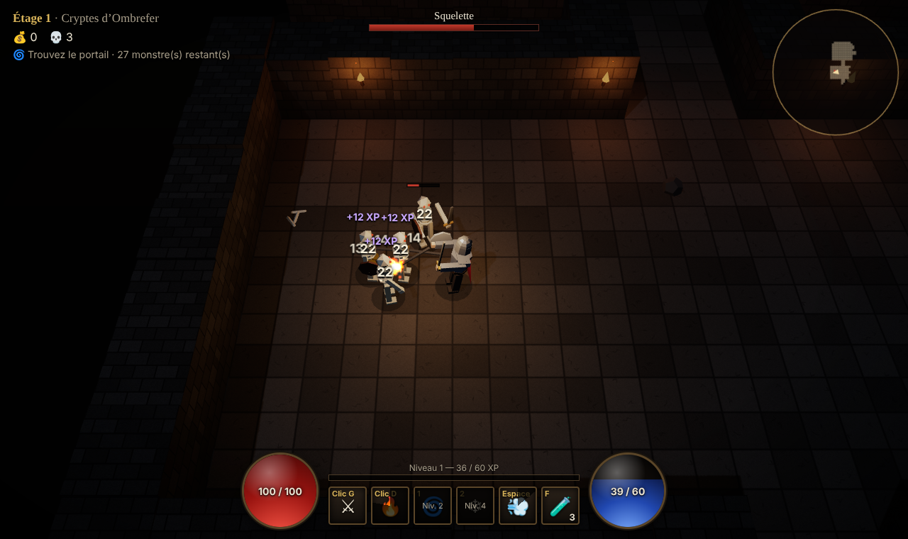

# Les Cryptes d'Ombrefer

Un hack'n'slash (ARPG) 3D jouable dans le navigateur, façon Diablo-like minimaliste.
Donjons générés à chaque étage, combat nerveux, loot à raretés, boss tous les 3 étages.

Tout est procédural : modèles low-poly, textures (canvas), sons (Web Audio). Aucun asset externe.



## Lancer le jeu

```bash
npm install
npm run dev        # http://localhost:5173
```

Build de production (dossier `dist/`, statique, servable n'importe où) :

```bash
npm run build
npm run preview
```

Le workflow GitHub Actions publie automatiquement `dist/` sur GitHub Pages à chaque push sur `main`
une fois Pages activé (Settings → Pages → Source : **GitHub Actions**).

## Commandes

| Touche | Action |
| --- | --- |
| ZQSD / WASD / flèches | Se déplacer (disposition détectée automatiquement) |
| Clic gauche (maintenu) | **Taille** — arc de mêlée devant le personnage |
| Clic droit | **Boule de feu** — explose en zone (mana) |
| 1 | **Tourbillon** — 4 coups tout autour (niveau 2) |
| 2 | **Nova de givre** — dégâts + ralentissement (niveau 4) |
| Espace | **Roulade** — bond invulnérable |
| F | Potion de vie |
| I / Tab / C | Inventaire et fiche de personnage |
| Molette | Zoom |
| Échap · M · P | Pause · couper le son · compteur FPS |

## Contenu de la v1

- **Donjon procédural** : salles + couloirs + boucles, piliers, torches, décor ; 4 ambiances qui alternent.
- **Monstres** : squelettes, archers (kiting), chauves-souris en nuée, goules massives (attaque télégraphiée),
  nécromanciens (projectiles à tête chercheuse + invocations), champions élites (bleus, ×2,8 PV, meilleur butin).
- **Boss** : Morvhal, le Roi-Liche, tous les 3 étages — frappe, onde de choc télégraphiée, anneau de projectiles,
  invocations à 66 % et 33 % de vie. Le portail ne s'ouvre qu'à sa mort.
- **Butin** : 6 emplacements, 4 raretés (commun, magique, rare, légendaire), 14 types d'affixes,
  comparaison avec l'objet porté, recyclage en or.
- **Progression** : XP / niveaux, compétences débloquées, difficulté croissante par étage.
- **Halte entre les étages** : marchand de potions, recyclage en masse.
- **Sauvegarde** automatique (localStorage) au début de chaque étage ; « Réessayer l'étage » après une mort.
- **Réglages** : volume, nombres de dégâts, mode performance (sans ombres).

## Architecture

```
src/
  core/        Logique pure, testée (aucune dépendance à Three.js)
    rng.ts         Générateur déterministe (mulberry32)
    dungeon.ts     Génération du donjon + BFS
    flowfield.ts   Champ de flux pour la poursuite des monstres
    stats.ts       Statistiques, XP, armure, mise à l'échelle des monstres
    loot.ts        Objets, raretés, affixes, noms
    character.ts   Personnage : inventaire, équipement, niveaux
    save.ts        Sauvegarde / records / réglages
  game/        Rendu et simulation (Three.js)
    Game.ts        Boucle, états, étages, butin, caméra, lumières
    player.ts      Joueur et compétences
    enemies.ts     IA et attaques des monstres + boss
    projectiles.ts Projectiles et télégraphes au sol
    world.ts       Construction 3D de l'étage, collisions, ligne de vue
    models.ts      Personnages low-poly procéduraux + animation
    particles.ts   Système de particules (un seul draw call)
    audio.ts       Effets sonores synthétisés
    input.ts       Clavier / souris (par code physique)
  ui/ui.ts     HUD, inventaire, infobulles, écrans (DOM)
```

## Tests

```bash
npm test                         # tests unitaires (Vitest) de la logique core
npm run build && npm run e2e     # partie complète dans Chromium headless + captures dans screenshots/
node scripts/boss.mjs            # scénario du boss
```

Les scripts navigateur utilisent `playwright-core` avec le Chromium de `@sparticuz/chromium`
(ou celui indiqué par `CHROMIUM_PATH`). Le rendu y passe par SwiftShader (logiciel) : c'est lent, c'est normal.

`window.__game` est exposé pour le débogage (`__game.debugState()`).

## Pistes pour la suite

- Classes jouables (archer, mage) et arbre de compétences
- Objets uniques avec effets spéciaux (ricochet, explosion à la mort…)
- Contrôles manette et tactiles
- Musique d'ambiance générative
- Coffres, pièges, tonneaux destructibles, événements de salle
